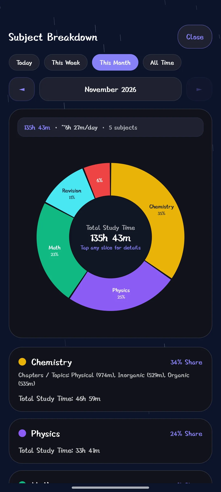
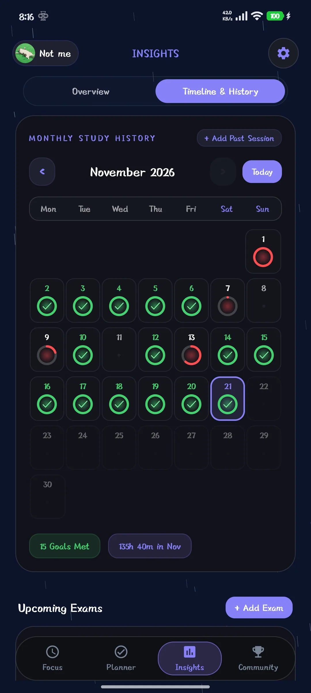
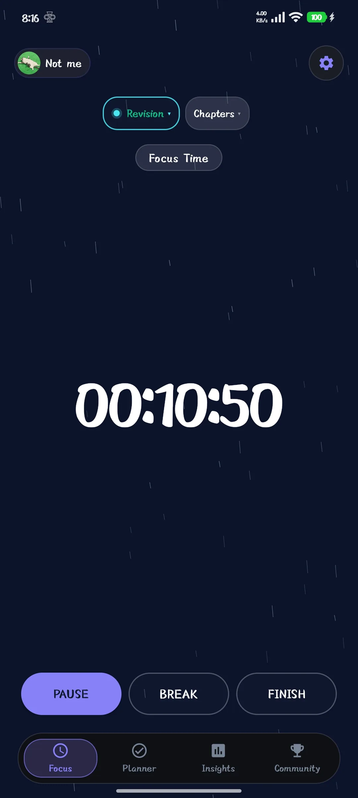

# ⏱️ StudyTimer — Free, Ad-Free Focus Companion & Web Studio

<p align="center">
  
</p>

<p align="center">
  <strong>The 100% free, distraction-free Pomodoro study timer and habit tracker built for students, exam candidates, and self-learners.</strong>
</p>

<p align="center">
  
  
  
  
  
</p>

---

## 🔗 Quick Links

| Destination | Link |
| :--- | :--- |
| 🌐 **Official Website** | [https://get-studytimer.vercel.app](https://get-studytimer.vercel.app/) |
| ⚡ **Try in Browser (Web Studio)** | [https://get-studytimer.vercel.app/study](https://get-studytimer.vercel.app/study) |
| 📥 **Direct APK Download** | [StudyTimer-release.apk (v3.3.6)](https://raw.githubusercontent.com/JAIstudio-source/StudyTimer/main/StudyTimer-release.apk) |
| 📖 **Privacy Policy** | [Privacy Policy](https://get-studytimer.vercel.app/privacy.html) |
| 📜 **Terms of Service** | [Terms of Service](https://get-studytimer.vercel.app/terms.html) |
| 🗑️ **Account & Data Deletion** | [Self-Serve Deletion Portal](https://get-studytimer.vercel.app/delete-account.html) |
| 💬 **Contact Support** | [Contact Form](https://get-studytimer.vercel.app/contact.html) • `studytimer737@gmail.com` |

---

## 🎯 Why StudyTimer?

Most timer and study apps on mobile app stores are overloaded with intrusive 30-second video advertisements, expensive monthly subscriptions, locked basic analytics, and excessive background trackers.

**StudyTimer was created to be the exact opposite:**
- **100% Free Forever**: Every feature, analytics chart, custom subject, and Pomodoro mode is fully unlocked with zero fees.
- **Zero Advertisements**: No banner ads, interstitial popups, or rewarded video interruptions that break deep study flow.
- **Offline-First by Design**: All timers, subjects, and study sessions write immediately to an on-device encrypted database. You never need an internet connection to study.
- **Optional Encrypted Cloud Sync**: Seamlessly sync streaks and backups across Android and web browsers with Supabase PostgreSQL and Row Level Security.
- **Strict Student Privacy**: Fully compliant with India's **Digital Personal Data Protection Act, 2023 (DPDP Act)** and global privacy standards.

---

## ✨ Key Features

### 1. ⏳ Flexible Focus Modes
- **Classic Stopwatch**: Tap to start, pause, and log unstructured study sessions with millisecond precision.
- **Customizable Pomodoro**: Preset 25/5 or 50/10 intervals, or dial in custom focus/break periods with automated session cycles.
- **Dynamic Landscape Desk Clock**: Transform your phone or tablet into an ambient desk clock while studying.

### 2. 📚 Subject & Tag Tracking
- Unlimited custom subjects (e.g., *Mathematics*, *Organic Chemistry*, *Data Structures*, *Constitutional Law*).
- Custom hex color palettes to categorize and visually differentiate focus areas.
- Target study goals per subject with daily and weekly progress meters.

### 3. 🎧 Ambient Study Soundscapes
- Built-in soothing background sounds engineered to mask distractions and trigger deep focus:
  - 🌧️ *Gentle Rain*
  - 🪵 *Cozy Fireplace*
  - 🌊 *Rolling Ocean Waves*
  - 🔔 *Soft Temple Bells*

### 4. 📈 Consistency Analytics & Streak Heatmaps
- **Monthly Heatmap Calendar**: Visual GitHub-style contribution grid of your daily study intensity.
- **Streak Protection**: Track current and best streaks with automated rollover handling.
- **Weekly Summary Cards**: Generate and export high-resolution performance cards to share with study groups or mentors.

### 5. ⚡ Web Studio (Try in Browser)
- Don't have your phone nearby? Open [get-studytimer.vercel.app/study](https://get-studytimer.vercel.app/study) on your laptop or Chromebook.
- Full offline IndexedDB support with optional real-time cloud sync.

---

## 📱 App Screenshots

| Home Timer | Subject Analytics | Monthly Heatmap | Pomodoro Mode |
| :---: | :---: | :---: | :---: |
|  |  |  |  |

---

## 🛠️ Architecture & Tech Stack

```
StudyTimer Architecture
├── Android Client (Kotlin)
│   ├── UI: Custom Canvas Views (TimerRingView, HeatmapView, WeeklyCardView)
│   ├── Storage: Room / SQLite (Offline-First Local Persistence)
│   ├── Services: Foreground TimerService with WakeLock and Notification Channels
│   └── Networking: OkHttp / Supabase Kotlin SDK with TLS 1.3
├── Web Platform (Modern Web Standards)
│   ├── Frontend: Vanilla ES6+, Semantic HTML5, Modern CSS Variables
│   ├── Storage: IndexedDB, LocalStorage, Service Worker (PWA offline caching)
│   └── Analytics: Vercel Web Analytics & Speed Insights
└── Backend & Cloud Infrastructure
    ├── Database: Supabase PostgreSQL with strict Row Level Security (RLS)
    ├── Security: SECURITY DEFINER RPCs with immutable search_path and rate clamps
    └── Hosting: Vercel Edge Global CDN
```

---

## 🔒 Security & Privacy Standards

In accordance with our strict engineering and privacy mandates:
- **Zero Public Admin Dashboards**: No client-side administrative HTML panels or exposed inspection UIs.
- **Strict Row Level Security (RLS)**: Wildcard open policies (`USING (true) WITH CHECK (true)`) are strictly banned. All mutations use velocity-verified PostgreSQL functions (`record_study_session_leaderboard`, `sync_study_progress_leaderboard`, `sync_offline_study_sessions`).
- **Data Minimization**: We never access contacts, GPS location, microphone, camera, or SMS.
- **1-Click Permanent Deletion**: Users can delete all cloud data and profiles instantly at [delete-account.html](https://get-studytimer.vercel.app/delete-account.html).

---

## 🚀 Getting Started

### Install on Android
1. Download [`StudyTimer-release.apk`](https://raw.githubusercontent.com/JAIstudio-source/StudyTimer/main/StudyTimer-release.apk) directly to your Android device.
2. Tap the downloaded APK to install (enable "Install unknown apps" if prompted).
3. Open StudyTimer and start your first focus session immediately — zero account required.

### Local Development (Website & Web Studio)
```bash
# Clone the repository
git clone https://github.com/JAIstudio-source/StudyTimer.git
cd StudyTimer

# Install test dependencies
npm install

# Run automated readiness & security test suite
npm test

# Serve locally
npx serve . -l 3000
```

---

## 📬 Support & Community

- **Official Email**: `studytimer737@gmail.com`
- **Issue Tracker**: [GitHub Issues](https://github.com/JAIstudio-source/StudyTimer/issues)
- **Organization**: StudyTimer / JAI Studio

---

<p align="center">
  <sub>© 2026 StudyTimer. Made with care for students everywhere.</sub>
</p>
